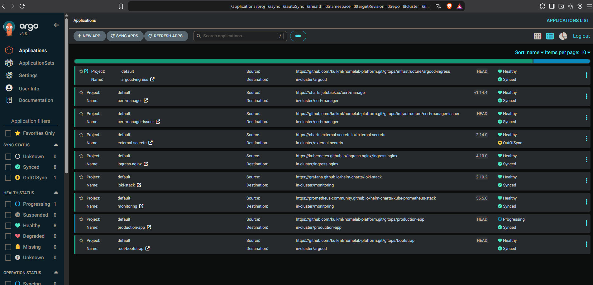
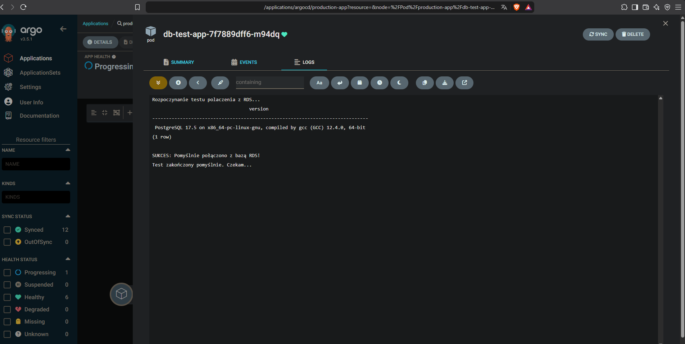
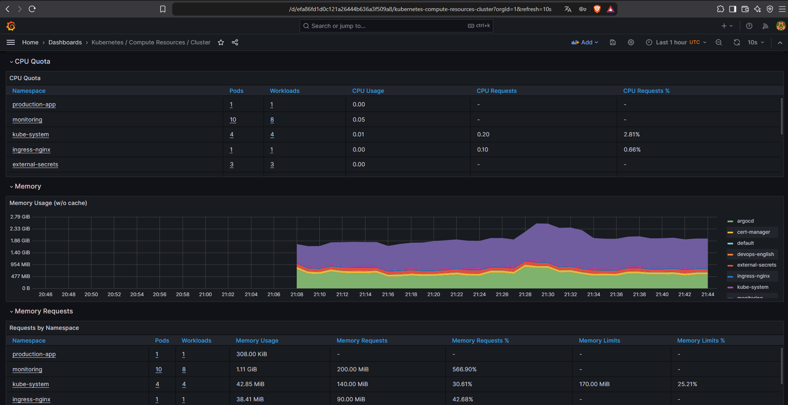

# 🚀 Production-Ready K3s Hybrid Platform & GitOps Infrastructure


Production-grade, hybrid Kubernetes infrastructure setup running on local Proxmox environment integrated with AWS Cloud Services using GitOps principles.
---

## 📸 Project Gallery & Validation

### 1. GitOps State (ArgoCD Dashboard)
All cluster components, ingress controllers, certificate managers, and the monitoring stack managed declaratively through GitOps.


### 2. Hybrid Connectivity & RDS Integration
Validation of successful database connectivity from the K3s cluster over the Tailscale VPN tunnel to AWS RDS.


### 3. Observability Stack (Grafana)
Cluster-wide resource utilization and monitoring dashboards powered by Prometheus.


## 📋 Architecture Overview

```mermaid
graph TB
    subgraph Proxmox Homelab
        subgraph K3s Cluster
            Argo[ArgoCD GitOps] --> App[Production App]
            App --> ESO[External Secrets Operator]
            Prom[Prometheus & Loki] --> Graf[Grafana UI :30300]
        end
        Tail[Tailscale Subnet Router]
    end

    subgraph AWS Cloud (Terraform)
        VPC[AWS VPC] --> RDS[(AWS RDS PostgreSQL)]
        VPC --> SM[AWS Secrets Manager]
    end

    Tail -.->|Secure VPN Tunnel| VPC
    ESO -->|Fetch Secrets| SM
    App -->|Database Traffic| RDS

### Key Features
- **GitOps Deployment:** Fully automated cluster state management via **ArgoCD**.
- **Hybrid Cloud Integration:** Local K3s cluster syncs sensitive workloads with **AWS Secrets Manager** via **External Secrets Operator (ESO)** over Tailscale VPN tunnel.
- **Application Design Patterns:** Custom microservice workloads utilizing the **Sidecar Pattern** for log processing and rotation.
- **Security & Isolation:** Strict `NetworkPolicies` for namespace isolation, least-privilege `ServiceAccounts`, and RBAC enforcement.
- **Infrastructure as Code:** Public cloud components provisioned deterministically using **Terraform**.

---

## 🛠️ Tech Stack

| Domain | Tools & Technologies |
| :--- | :--- |
| **Orchestration** | K3s (Kubernetes), Proxmox VE |
| **GitOps** | ArgoCD |
| **Cloud Provider** | AWS (Secrets Manager, IAM, VPC, RDS, EC2) |
| **Secrets Management** | External Secrets Operator (ESO) |
| **IaC** | Terraform, Ansible |
| **Observability** | Prometheus, Grafana, Loki |

---

## 🗺️ Roadmap & Current Status

- [x] Proxmox K3s Cluster Provisioning & Networking
- [x] ArgoCD Core Installation & Application Bootstrap
- [x] AWS Cloud Provisioning (VPC, SecretManager, S3, EC2, RDS)
- [x] Tailscale - hybrid cloud tunnel AWS <-> Proxmox
- [x] Custom Workload Deployment
- [x] NetworkPolicy Isolation & RBAC Setup
- [x] Terraform IAM & RDS Automation Setup
- [x] Full Observability Stack (Prometheus + Grafana + Loki)


